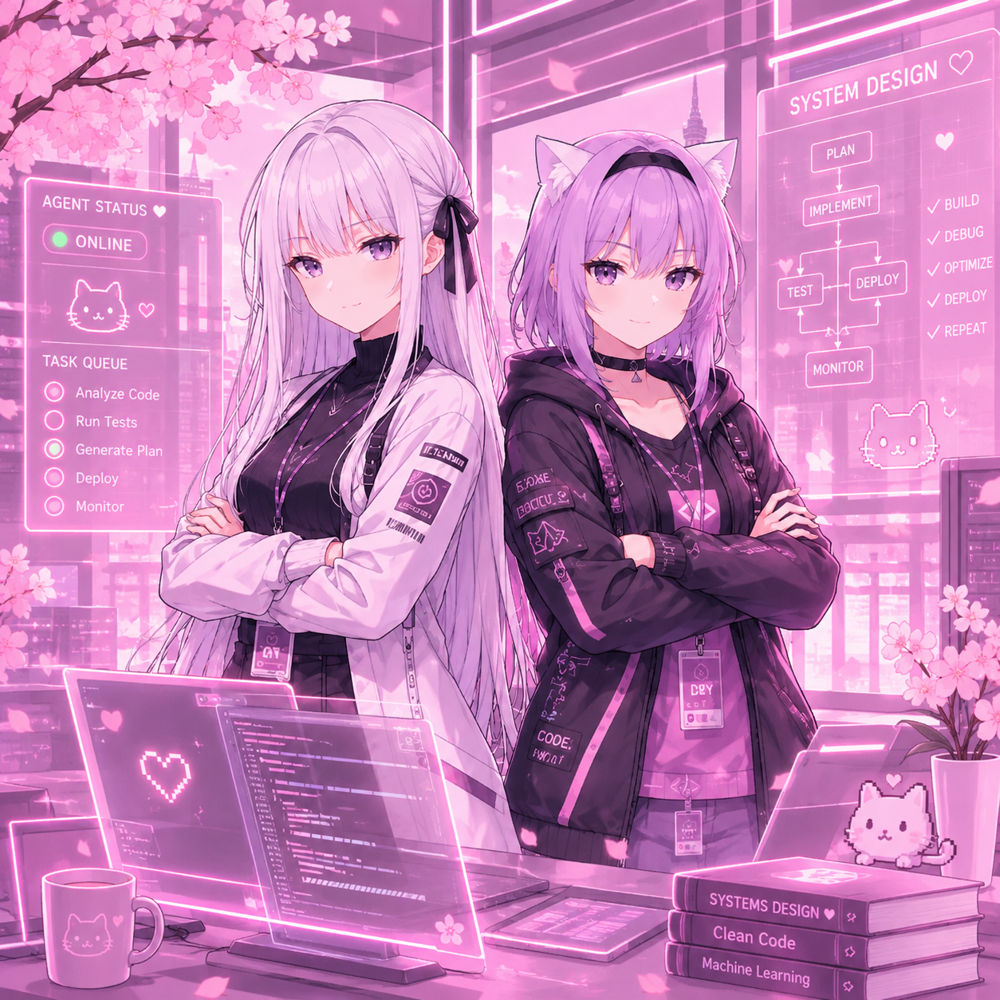

# Zanshin Harness

Zanshin Harness is a focused, local-first workspace for coding agents. The interface keeps the current run, task queue, system flow, context budget, and safety posture visible without turning the workspace into a command center full of noise.



## Current build

Zanshin Harness runs as a standalone Electron desktop app and chats with a local Ollama instance. Sessions and preferences stay on the device. Plan and Build change how the model responds; neither mode reads or edits workspace files or runs commands. The folder picker saves a path for reference only.

## Quickstart

Install dependencies once, then launch the native desktop GUI:

```bash
npm install
npm run desktop
```

For chat, install [Ollama](https://ollama.com/download), start it on `127.0.0.1:11434`, and pull a model, for example `ollama pull qwen2.5-coder:7b`. Enter the exact name shown by `ollama list` in Settings or via `/model`.

For live development, use `npm run desktop:dev`. On Windows, `npm run package -- --win` builds a Windows installer under `release/`. On Linux, `npm run package` builds an AppImage.

Useful checks:

```bash
npm run typecheck
npm run lint
npm run build
```

## Commands

| Command | What it does |
| --- | --- |
| `/ctxlimit 12k` | Set the estimated history budget (1,024–24,500 tokens). |
| `/ctxstatus` | Show estimated history usage. |
| `/clearcontext` | Reset model context without deleting the transcript. |
| `/wordlimit 2` | Cap assistant replies at two words (`/textlimit` also works). |
| `/textlimit on\|off\|toggle` | Toggle the text limiter. |
| `/mode plan\|build` | Switch the active work mode. |
| `/model` | Open model settings. |

Keyboard shortcuts: `Ctrl/Cmd + K` opens the command palette, `Alt + M` switches modes, and `Ctrl/Cmd + Alt + L` toggles the text limiter.

## Design direction

The visual language takes its cues from the included background art: lavender and cherry-pink neon, deep plum contrast, glass panels, small HUD labels, and a restrained falling-petal layer. Reduced-motion preferences are respected.

## Project layout

| Path | Purpose |
| --- | --- |
| `electron/main.cjs` | Native window lifecycle and secure renderer loading. |
| `electron/preload.cjs` | Minimal isolated desktop bridge. |
| `src/App.tsx` | Workspace layout and interaction states. |
| `src/index.css` | Theme, responsive layout, glass HUD styling, and motion. |
| `public/aestheticharness.png` | Background art for the workspace. |

## License

MIT. See [LICENSE](LICENSE).
